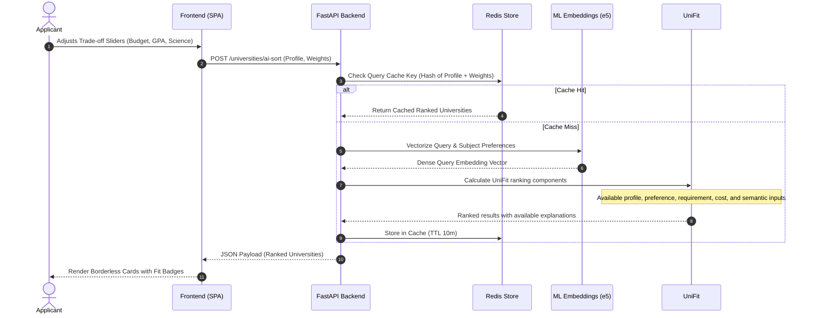

# UniSearch System Architecture

This document provides a comprehensive overview of the UniSearch technical architecture, system components, data flows, and security model.

---

## 1. System Overview & Component Topology

UniSearch is a web application with a vanilla JavaScript frontend and a Python FastAPI API. It serves a source-backed university catalog, optional applicant-profile calculations, and localized program and admission information. Redis is an optional cache; semantic embeddings are available when the configured model is installed.

```mermaid
flowchart TD
    subgraph Client ["Client Layer (Browser)"]
        UI["Calm Academic UI\n(HTML5, Vanilla ES Modules, CSS Tokens)"]
        State["State Management\n(LocalStorage, URL Routing, SafeStorage)"]
        I18N["Client-side Localization\n(English, Russian, Kazakh)"]
    end

    subgraph Gateway ["Edge / Reverse Proxy Layer"]
        Proxy["Reverse Proxy / CDN\n(TLS 1.2+, HTTPS Termination, Host Guard)"]
    end

    subgraph Backend ["Application Layer (FastAPI)"]
        MW["Security Middleware\n(Rate Limiter, Body Limit, CSP, Proxy Guard)"]
        Routers["API Routers\n(/universities, /ai-sort, /compare, /exams)"]
        UniFit["UniFit Composite Engine\n(Personalized Ranking, Sliders)"]
        UniChance["UniChance\n(Published Requirements Fit)"]
        ML["ML Semantic Service\n(multilingual-e5 Embeddings, Vector Cosine)"]
    end

    subgraph Persistence ["Data & Cache Layer"]
        Redis[("Optional Redis Cache\n(Query and rate cache)")]
        Disk[("Source-Controlled JSON Catalog\n(Coverage varies by institution)")]
        Media[("Media Assets\n(1:1 PNG Logos, 16:9 WebP Thumbnails)")]
    end

    subgraph External ["External Interfaces"]
        CDN["unpkg\n(Pinned Leaflet assets)"]
        Tiles["OpenStreetMap\n(Map tiles)"]
        Rates["ExchangeRate-API\n(Currency rates)"]
        ModelRegistry["Hugging Face Hub\n(Model weights, when needed)"]
        Telemetry["Sentry\n(Optional telemetry)"]
    end

    UI <--> |HTTP / JSON over HTTPS| Proxy
    Proxy <--> |Reverse Proxy (127.0.0.1:8000)| MW
    MW --> Routers
    Routers --> UniFit
    Routers --> UniChance
    UniFit <--> ML
    Routers <--> Redis
    Routers --> Disk
    Routers --> Media
    UI --> CDN
    UI --> Tiles
    Routers --> Rates
    ML --> ModelRegistry
    Routers -.-> Telemetry
```

---

## Actors and External Interfaces

| Actor or interface | Purpose and data flow |
| --- | --- |
| Applicant or visitor | Browses public catalog data without an account. Optional profile evidence is kept in browser storage and sent to the API only when needed for a requested calculation or ranking. |
| Contributor and maintainer | Contributors propose source, code, documentation, or data changes through pull requests. Maintainers review and merge changes, administer access, and publish releases. |
| Browser to frontend | The browser downloads static HTML, JavaScript, CSS, and catalog media from the configured frontend host over HTTPS. |
| Browser to FastAPI | The frontend sends JSON requests to the runtime-configured API base. Main routes cover catalog search and details, admissions context, UniFit ranking, UniChance requirements fit, ROI, validation, and currency rates. Request and response behavior is described in [the API and admissions runtime contract](admissions-runtime-contract.md); CORS and deployment guidance are in [deployment security](deployment_security.md). `/docs` and `/openapi.json` are available only when `DOCS_ENABLED=1`. |
| Browser to unpkg and OpenStreetMap | The map loads version-pinned Leaflet assets from unpkg and map tiles from OpenStreetMap. Tile requests use catalog coordinates; applicant profile data is not sent to these providers. |
| FastAPI to ExchangeRate-API | When currency-rate retrieval is enabled, the backend requests exchange rates from the configured `CURRENCY_RATES_API_URL`. The request contains currency-rate parameters, not applicant profile evidence. |
| FastAPI to Redis | When configured, Redis stores bounded cache entries. Redis is not the authoritative catalog and can be disabled or unavailable without making it the source of application data. |
| FastAPI to Hugging Face Hub | The configured sentence-transformer model (default `intfloat/multilingual-e5-base`) may be downloaded during initialization if it is not already available. Embedding inference runs in the backend; applicant profiles are not sent to the model registry. |
| FastAPI to Sentry | If `SENTRY_DSN` is configured, the backend sends filtered error and transaction telemetry. Default PII and local-variable capture are disabled, and sensitive fields are scrubbed before transmission. |
| Release workflow to GitHub | GitHub Actions builds versioned ZIP assets and a backend container image, publishes them to GitHub Releases and GHCR, and creates build-provenance attestations. |

The backend links users to official university sources but does not fetch arbitrary applicant-supplied URLs. Runtime hosts, the API base, currency provider, optional Redis, model location, and optional telemetry are deployment configuration rather than hardcoded application addresses.

---

## 2. Frontend Layer (Calm Academic Workspace)

The frontend uses **Vanilla JavaScript (ES Modules)**, HTML5, and CSS without a UI framework.

### Key Architectural Modules

* **Router & Page Controller (`frontend/javascript/routes.js`):**
  Manages single-page application (SPA) routing, browser history (`pushState` / `popstate`), query parameter synchronization, and viewport lifecycle transitions.
* **Global Search Component (`frontend/javascript/components/navbar-search.js`):**
  Provides a debounced (180ms) autocomplete typeahead with keyboard navigation (arrow keys, Enter, Escape), matched alias badges, network status monitoring, and full mobile drawer overlay.
* **Localization Subsystem (`frontend/javascript/i18n.js`):**
  Dynamic client-side internationalization supporting English, Russian, and Kazakh without full page reloads. Strings are loaded from `frontend/Localization/` with a fallback key mechanism.
* **State Persistence (`frontend/javascript/utils/persistence.js` & `safe-storage.js`):**
  Safely syncs applicant preferences (GPA, exam scores, budget, currency choices, comparison trays) to browser `localStorage` with migration versioning and corrupted JSON recovery.
* **Design System & Styling (`frontend/css/style.css`):**
  Adheres strictly to the **Calm Academic Workspace** specification (`docs/design-system.md`):
  - **Borderless by default:** Components use semantic surface shifts (`--bg` → `--surface-solid` → `--surface-soft`) and micro-elevation (`--shadow-xs`) rather than box borders.
  - **4/8-px spacing scale:** Strict layout rhythm without arbitrary margin/padding offsets.
  - **Theming:** Clean Light and Dark modes driven by CSS variables at the `:root` level, meeting WCAG 2.2 AA contrast standards.

---

## 3. Backend Layer (FastAPI API)

The backend is built with **Python 3.12+ and FastAPI**, using ASGI and Pydantic V2 request and response models.

```
backend/app/
├── core/
│   ├── security.py       # Sliding-window rate limiter, proxy resolution, CSP headers
│   ├── redis_store.py    # Robust Redis client with automatic fallback suppression
│   ├── settings.py       # Pydantic BaseSettings with typed environment overrides
│   └── observability.py   # Metrics collection, request duration tracking, structured logging
├── routers/
│   ├── universities.py   # Core catalog, search, AI sort, ROI, and comparisons
│   ├── exams.py          # Standardized exam validation & scoring bounds
│   ├── languages.py      # Language proficiency framework mappings
│   └── root.py           # Health probes (/health, /ready), ops admin endpoints
├── schemas/
│   └── payloads.py       # Pydantic V2 request & response contracts
└── services/
    ├── ai_scoring.py     # UniFit composite personalized ranking & UniChance algorithms
    ├── ml_scoring.py     # Multilingual neural embeddings & semantic vector search
    ├── search.py         # Multi-criteria filtering, fuzzy normalization & sorting
    └── background_tasks.py # Async startup sync, currency warmup, ML model initialization
```

### Request Lifecycle & Defense-in-Depth Pipeline

1. **Host Header Validation:** Discards requests with unapproved hostnames.
2. **Payload Size Guard:** Rejects incoming request bodies exceeding 128 KiB (`REQUEST_BODY_MAX_BYTES`) with HTTP 413.
3. **Client IP Resolution (`request_client_ip`):** Evaluates `X-Forwarded-For` right-to-left against configured `TRUSTED_PROXY_IPS` and private network ranges, rejecting client-spoofed headers.
4. **Sliding-Window Rate Limiter:** Enforces IP-based rate limits (global requests and expensive calculation budgets) using memory-safe sliding window counters.
5. **Contract Enforcement:** Request payloads are deserialized and strictly validated against Pydantic models in `backend/app/schemas/payloads.py`. Invalid parameters trigger structured HTTP 422 errors.
6. **Security Headers Middleware:** Injects defensive headers into every HTTP response:
   - `Content-Security-Policy (CSP)`
   - `X-Content-Type-Options: nosniff`
   - `X-Frame-Options: DENY`
   - `Referrer-Policy: strict-origin-when-cross-origin`

---

## 4. Scoring & Intelligence Engine

UniSearch keeps personalized ranking separate from published-requirement checks. Neither system represents an admission outcome or funding decision.



### A. UniFit (Composite Personalized Ranking)
Implemented in `backend/app/services/ai_scoring.py`, UniFit ranks catalog options using the applicant's selected profile context, preference weights, and available cost, academic, language, interest, and semantic inputs. Unavailable components are omitted rather than filled with invented values. UniFit is a sorting aid, not an admission probability or an aid prediction.

### B. UniChance (Published Requirements Fit)

UniChance reports the percentage of evaluable, published academic and language minimum checks met for the applicable admission choice. Its denominator excludes evidence-presence checks, funding conditions, and nonnumeric or holistic requirements. It is a requirements-fit measure, not a probability of admission, overall eligibility decision, or funding prediction.

The API calculates this value separately through `POST /universities/{university_id}/uni-chance`. Missing required evidence, unresolved numeric applicability, an unsupported numeric minimum, an unreviewed route, or a route with no measurable published minimums produces no percentage. A known unmet measurable minimum may produce zero. Published admitted-score ranges and acceptance rates remain separate context and do not generate or adjust this percentage. See the [admissions product model](admissions-product-model.md#scoring-meaning-and-unresolved-decisions) and [runtime contract](admissions-runtime-contract.md) for its evidence and response contract.

### C. ML Semantic Matching (`multilingual-e5`)
Implemented in `backend/app/services/ml_scoring.py`:
* Uses dense multilingual sentence embeddings; the default model is `intfloat/multilingual-e5-base`, configurable through `ML_SEMANTIC_EMBEDDINGS_MODEL`.
* Enables multilingual semantic query expansion (e.g. an applicant querying in Russian or Kazakh naturally matches English and German program descriptions).
* **Unavailable Mode:** If the model or PyTorch is disabled or unavailable, the API reports `unavailable` mode. It does not silently substitute lexical matching for a missing semantic result.

---

## 5. Data Architecture & Caching Strategy

### Data Storage Model
* **Catalog (`backend/data/`):**
  Stored as structured JSON files under source control. Coverage varies by institution and program; missing facts remain unknown rather than being inferred. Admission facts are scoped to their source, program, applicant route, and cycle where published.
* **Asset Directory (`backend/data/university_assets/`):**
  - Institutional logos: 1:1 square PNG format with responsive fallbacks.
  - Campus thumbnails: 16:9 WebP and JPEG images generated in multiple responsive resolutions.
* **Data Auditing (`npm run audit:data`):**
  Automated script validating schema conformance, URL liveliness, required fields, and asset presence before any release.

### Redis Caching Layer (`app/core/redis_store.py`)
* **Environment-Isolated Key Namespaces:** All cache keys are dynamically prefixed with deployment environments (e.g. `unisearch:prod:`, `unisearch:test:`).
* **Graceful Failure Suppression:** Redis errors (connection timeouts, cluster restarts) are trapped and logged without bubbling to the client. The system transparently falls back to computing fresh responses.
* **Ping Caching:** Connection liveness is cached for 10 seconds to eliminate redundant network roundtrips during health probes.

---

## 6. Observability, Health & Startup Lifecycle

UniSearch provides fine-grained observability for production hosting:

* **`/health`:** Lightweight liveness check for load balancers. Returns HTTP 200 with system uptime.
* **`/ready`:** Readiness probe validating catalog data load, Redis connectivity, and embedding model availability.
* **`/metrics`:** Exposes Prometheus-compatible operational counters: request counts, duration histograms, cache hit/miss ratios, and rate-limit triggers.
* **`/ops/*` (Ops Admin Endpoints):** Protected administrative endpoints requiring `OPS_ADMIN_TOKEN` for on-demand cache flushing, catalog reload, and runtime diagnostics.
* **Background Startup Synchronization (`app/services/background_tasks.py`):**
  Upon application start, an asynchronous warmup routine loads the catalog into memory, primes currency conversion tables from open exchange rate feeds, and initializes ML vector indices in the background without blocking initial HTTP readiness.

---

## 7. Verification & Testing Strategy

The repository enforces progressive, layered testing:

| Test Layer | Framework | Scope and trigger |
| --- | --- | --- |
| **Backend Unit & API** | Python `unittest` + `TestClient` | Routers, scoring, Redis integration, security middleware, and schemas; required on PRs. |
| **Frontend Unit** | Node.js test runner | Formatting, search, localization, persistence, and DOM behavior; required on PRs. |
| **Browser Integration** | Playwright | Chromium applicant and catalog journeys; required on PRs. A broader browser matrix runs nightly. |
| **Security Analysis** | GitHub CodeQL, npm audit, pip-audit, and Trivy | CodeQL and dependency audits run on PRs. Trivy scans repository files for secrets and configuration; it is not a container-image vulnerability scan. |
| **Repository Checks** | GitHub Actions and SonarCloud | Version, encoding, tokens, localization, data, and quality checks; required statuses are configured on the primary branch. |
| **Fuzzing** | Google ClusterFuzzLite / Atheris | Fuzzes selected backend paths on PRs and runs on a schedule. |
