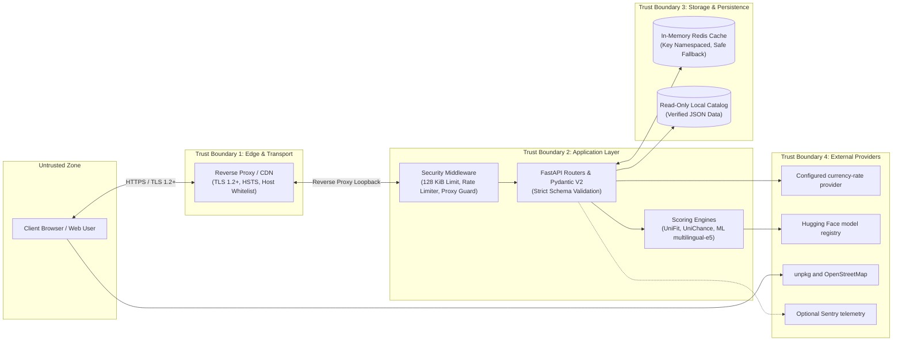

# UniSearch Security Assurance Case

This document establishes the formal **Security Assurance Case** for the UniSearch project, satisfying the **OpenSSF Best Practices Silver Badge** criterion `assurance_case`.

Following NIST IR 7608 and OpenSSF guidelines, this document articulates our threat model, delineates explicit trust boundaries, demonstrates the application of secure design principles, and details defense-in-depth countermeasures against common software vulnerabilities.

---

## 1. Context and Threat Model

UniSearch is an open-source academic search and comparison application for undergraduate, master's, doctoral, and professional study. It has a static Vanilla JavaScript frontend, a Python FastAPI API, a source-controlled JSON catalog, optional Redis caching, and an optional multilingual-e5 embedding model. Visitors can browse without an account. When an applicant requests a personalized calculation, the selected profile evidence is sent to the API for that request; UniSearch does not keep a server-side account or profile database.

### 1.1 Asset Inventory & Critical Claims
* **Asset 1: Integrity of the University Catalog.** Tuition, admission requirements, and deadlines must remain tied to official sources and protected from unreviewed changes. Catalog coverage is incomplete and must not be presented as exhaustive.
* **Asset 2: Service Availability & Computational Resilience.** Personalized AI ranking (`UniFit`) and semantic vector lookups must be resilient against denial-of-service, resource exhaustion, and algorithmic complexity attacks.
* **Asset 3: Applicant Privacy.** Academic metrics, test scores, and budgets are personal applicant data. They are stored in the browser and sent to the API only for requested calculations. Optional Sentry telemetry disables default PII and local-variable capture and scrubs sensitive fields.
* **Asset 4: Administrative Operations.** Operations endpoints (`/ops/*`) must be strictly inaccessible to unauthorized clients.

### 1.2 Threat Actors & Threat Scenarios
1. **Automated Scrapers and DoS Attackers:** Malicious bots attempting to overwhelm public search, comparison, or scoring routes with high request volume or oversized payloads.
2. **Untrusted Web Clients:** Attackers sending malicious query parameters or payloads to trigger injection, cross-site scripting, unsafe parsing, or excessive computation.
3. **Compromised Contributors or Maintainer Accounts:** A stolen account or malicious change could alter source, workflows, catalog facts, secrets usage, or releases.
4. **Supply-Chain Attackers:** Compromised packages, GitHub Actions, model artifacts, CDN assets, or release credentials could introduce malicious code.
5. **Network and Service Adversaries:** Interception, tampering, or outage affecting public traffic, map tiles, currency rates, model downloads, or optional telemetry.

### 1.3 Qualitative Risk Assessment

Likelihood and impact are qualitative assessments for the current public web application and its two named repository maintainers. Ratings should be revisited after changes to access, deployment, data flow, or release automation.

| Scenario | Likelihood | Impact | Existing controls and response |
| --- | --- | --- | --- |
| Compromised repository account changes code or a release | Medium | High | MFA for repository administrators; pull requests required for the primary branch; required test, dependency, code-analysis, repository, and quality checks; release provenance attestations. Review collaborator access before increasing permissions. |
| Vulnerable or malicious dependency reaches a release | Medium | High | npm and Python lockfiles with hashes; dependency audits on pull requests; pinned GitHub Actions; maintainers review dependency changes and remediate audit findings before merge. |
| Applicant profile evidence is exposed through API logs or telemetry | Low to medium | High | No server-side profile database; bounded, schema-validated API requests; sensitive fields are scrubbed from optional Sentry events; default PII and local-variable capture are disabled. |
| Public requests exhaust API resources | Medium | Medium to high | Request-size limits, per-client rate limits, bounded input schemas, edge/reverse-proxy guidance, and safe Redis degradation. |
| Catalog or release content is altered without a trustworthy review | Low | High | Public Git history, source-backed data workflow, required pull requests and checks, and signed build-provenance attestations. |
| A third-party service is compromised or unavailable | Low to medium | Medium | HTTPS, pinned frontend map-library versions, fixed/configured provider endpoints, no applicant profile sent to map or rate providers, and optional rather than mandatory Redis, Sentry, and embeddings. |

---

## 2. Trust Boundaries and Data Flow

* **Trust Boundary 1 (Client to Edge):** Incoming requests originate from an untrusted network. The configured edge terminates TLS and validates host routing; any upstream volumetric filtering depends on the selected hosting provider. FastAPI also applies request-size and rate limits.
* **Trust Boundary 2 (Edge to Application):** FastAPI middleware enforces strict IP resolution from trusted reverse proxy headers, inspects payload size caps (128 KiB limit), and enforces rate-limiting before dispatching to endpoint controllers.
* **Trust Boundary 3 (Application to Storage):** The JSON catalog is read-only at runtime. Redis is an optional cache and is not the source of truth; no applicant profile database or untrusted catalog-write path exists.
* **Trust Boundary 4 (Application or Browser to External Providers):** Currency-rate retrieval, model downloads, map libraries and tiles, and optional telemetry use configured HTTPS providers. Applicant profile evidence is not sent to the map, rate, or model registries. Sentry is disabled unless a DSN is configured and sensitive fields are scrubbed before events are sent.

---

## 3. Secure Design Principles

UniSearch applies fundamental secure design principles across every layer:

1. **Least Privilege & Isolation:**
   * Backend Docker containers execute as an unprivileged, non-root user.
   * File access to the university catalog (`backend/data/`) is read-only at runtime.
   * Operations endpoints (`/ops/*`) require an explicit `OPS_ADMIN_TOKEN` secret.
2. **Defense in Depth:**
   * Multiple concentric verification layers: Edge TLS termination → Body size middleware → Sliding-window rate limiting → Pydantic V2 strict type validation → Domain engine boundary bounds checking.
3. **Fail-Safe Defaults & Graceful Degradation:**
   * If Redis is unreachable, the system automatically falls back to in-memory computation without crashing or failing requests (`app/core/redis_store.py`).
   * If neural embeddings or PyTorch are disabled (`ML_SEMANTIC_EMBEDDINGS_ENABLED=0`) or unavailable, the system reports `unavailable` mode without silently substituting lexical results.
4. **Stateless Privacy-First Architecture:**
   * UniSearch maintains zero server-side user sessions, zero passwords, and zero personal applicant profiles in databases.
   * Profiles and favorites persist in browser `localStorage`. Selected profile evidence is sent to the API for a requested calculation, but is not persisted as a server-side account or applicant profile.
5. **Complete Mediation:**
   * Every incoming HTTP request is intercepted and validated by uniform security middleware before touching application logic.

---

## 4. Countermeasures Against Common Implementation Weaknesses

| Vulnerability Class (OWASP) | Risk in UniSearch | Mitigation & Implementation Countermeasure |
| --- | --- | --- |
| **A01: Broken Access Control** | Unauthorized execution of management tasks | Public endpoints are strictly read-only catalog queries. Ops endpoints (`/ops/*`) require constant-time comparison against `OPS_ADMIN_TOKEN`. |
| **A02: Cryptographic Failures** | Data exposure in transit | Transport security is strictly enforced over HTTPS (TLS 1.2/1.3). Outbound HTTP requests use standard certificate verification (via Python `certifi`). |
| **A03: Injection (SQLi, Command Injection)** | Query tampering | **Zero SQL usage:** UniSearch does not use a relational SQL engine; catalog data is stored in immutable JSON. Incoming parameters are parsed and strongly typed via Pydantic V2 schemas. No dynamic `eval()` or shell subprocess execution on user input. |
| **A04: Insecure Design** | Architectural flaws | Documented system architecture (`docs/architecture.md`), RFC process for major changes (`GOVERNANCE.md`), and explicit data and API scope validation. |
| **A05: Security Misconfiguration** | Information leakage, bad headers | Defensive HTTP headers attached on every response: `Content-Security-Policy: default-src 'self'`, `X-Content-Type-Options: nosniff`, `X-Frame-Options: DENY`. Debug flags disabled in production environments. |
| **A06: Vulnerable & Outdated Components** | Known CVEs or insecure configuration in source and dependencies | npm audit and pip-audit run on pull requests and are required primary-branch checks. CodeQL analyzes JavaScript and Python and uploads findings for maintainer review. Trivy scans repository files for exposed secrets and configuration issues; it does not scan the published container image for vulnerabilities. |
| **A07: Identification & Auth Failures** | Credential stuffing, brute force | **Not Applicable to End Users:** UniSearch does not store user passwords, emails, or personal accounts. Local preferences remain in the user's browser. |
| **A08: Software & Data Integrity Failures** | Malicious packages, untrusted releases | Hash-verified dependency locks (`package-lock.json`, `backend/requirements.lock`, and `backend/requirements-dev.lock`). GitHub Sigstore provenance is verified in CI and published beside every release ZIP; container images carry registry attestations. |
| **A09: Security Logging & Monitoring** | Undetected attacks or downtime | Structured logging with correlation IDs, latency tracking, Prometheus metrics endpoint (`/metrics`), and health/readiness probes (`/health`, `/ready`). Sensitive variables and auth tokens are masked from all logs. |
| **A10: Server-Side Request Forgery (SSRF)** | Internal network probing | The backend does not fetch arbitrary user-supplied or university URLs. Server-side outbound requests use configured currency-rate and optional model sources; the browser loads map assets and tiles from their documented providers. |
| **Client-Side Cross-Site Scripting (XSS)** | Malicious script execution in browser | The Calm Academic Workspace frontend uses Vanilla JS with safe DOM manipulation (`textContent`, programmatic node construction) and strict sanitization. CSP headers prohibit inline unsafe scripts. |
| **Denial of Service (DoS / Resource Exhaustion)** | Server overload | Request payload size strictly capped at 128 KiB; sliding-window rate limiting enforced per client IP; debounced frontend autocomplete search inputs (180ms). |

---

## 5. Security Verification & Continuous Assurance

The project runs these checks as part of pull-request review and release preparation:

1. **Automated Static Analysis (SAST):**
   * GitHub CodeQL scans both Python and JavaScript codebases on every pull request and on a weekly scheduled cadence.
   * `npm audit` and `pip-audit` scan the locked JavaScript and Python dependencies for known advisories; the required dependency-audit status must pass before merge.
   * `Trivy` scans repository files for exposed secrets and configuration misconfigurations; findings are uploaded to GitHub code scanning. This workflow does not currently scan the built container image for package vulnerabilities.
   * The main-branch ruleset requires both CodeQL language analyses, dependency auditing, Trivy, repository guards, SonarCloud, DCO, backend tests, browser tests, and repository hygiene. Scorecard and fuzzing use their configured non-PR or path-specific triggers.
2. **Automated Coverage-Guided Fuzzing:**
   * Continuous fuzz testing integrated with **Google ClusterFuzzLite** and Atheris, fuzzing input parsing, JSON deserialization, and ranking computation engines against malformed or malicious inputs.
3. **High Statement & Branch Coverage:**
   * Automated unit, integration, and E2E test suites (Python `unittest`, Node.js test runner, Playwright) verifying scoring boundary conditions and error handling.
4. **Vulnerability Response & SLAs:**
   * Published policy in [SECURITY.md](../SECURITY.md) committing to **48-hour initial acknowledgment** and **14-day hotfix releases** for critical vulnerabilities, with public attribution in our Security Hall of Fame.

---

## 6. Conclusion and Claim Justification

This assurance case records the system's current trust boundaries, risks, and controls. It is a point-in-time engineering assessment, not proof that the application is free of vulnerabilities or an independent certification. Review it when architecture, integrations, access, or release workflows change.
